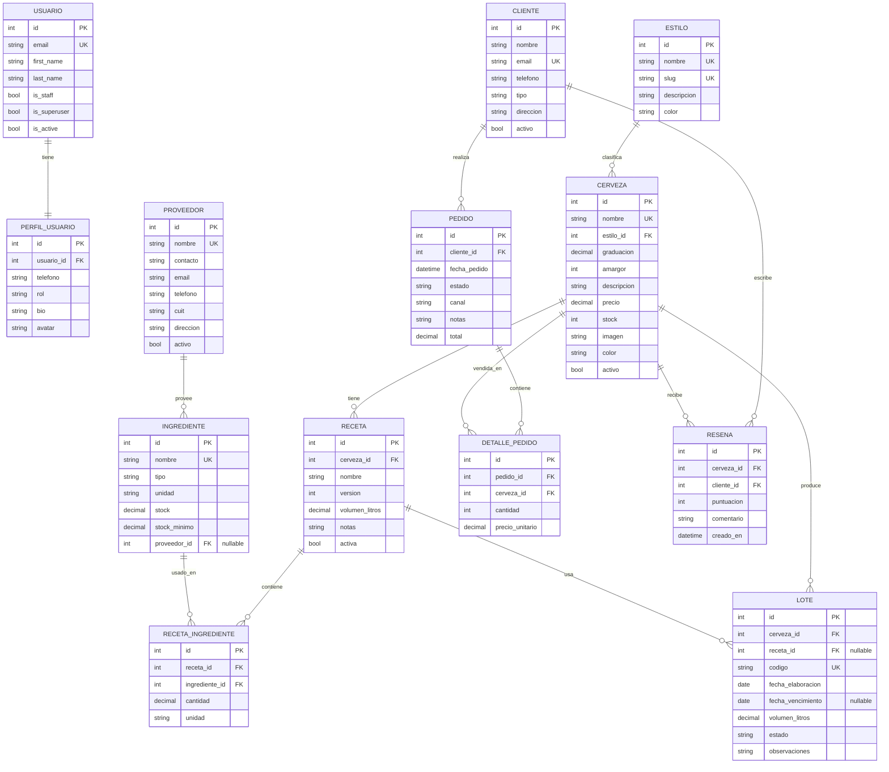
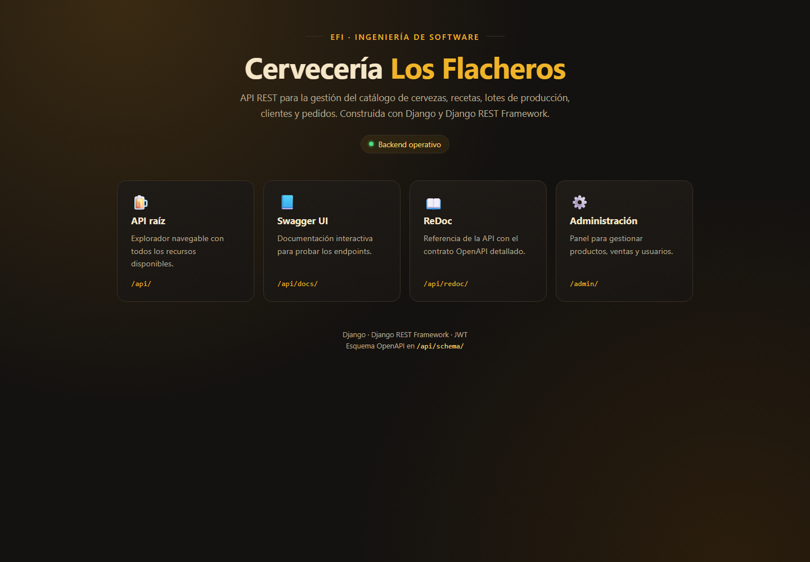
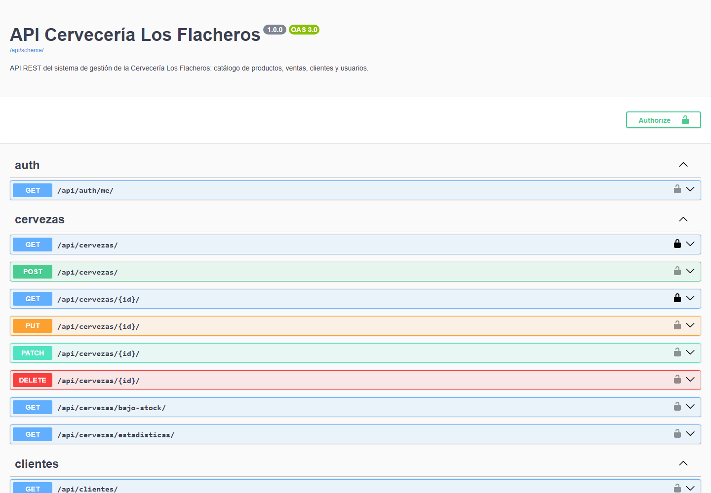
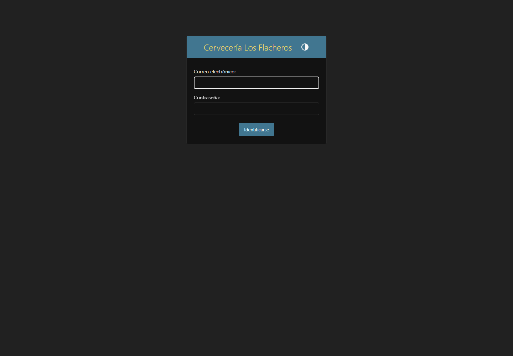
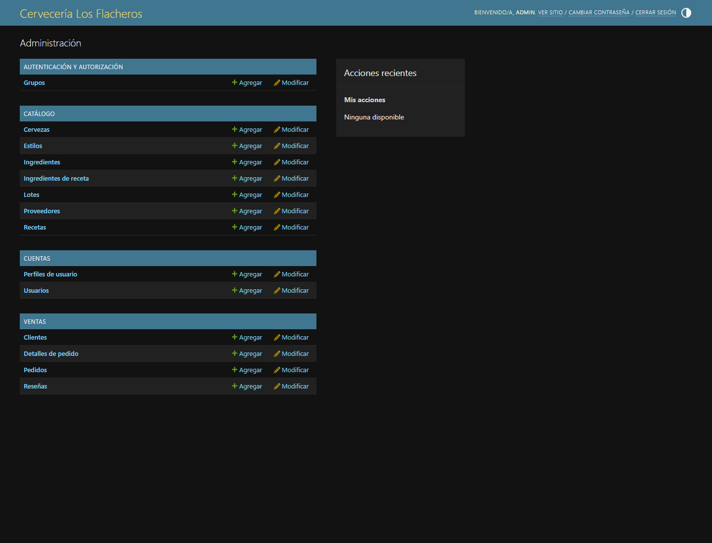
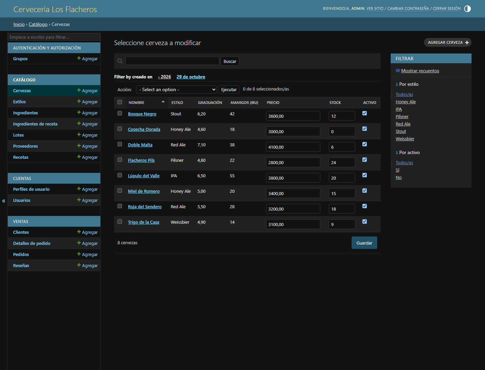
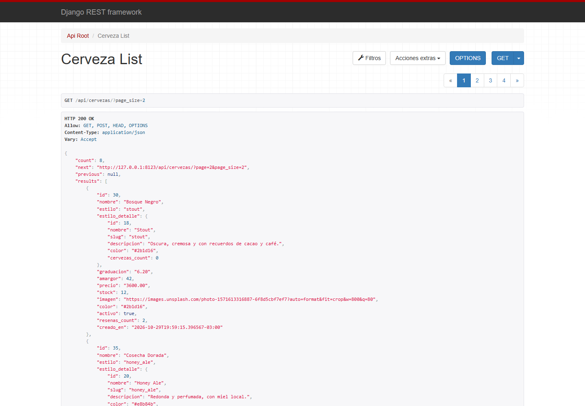
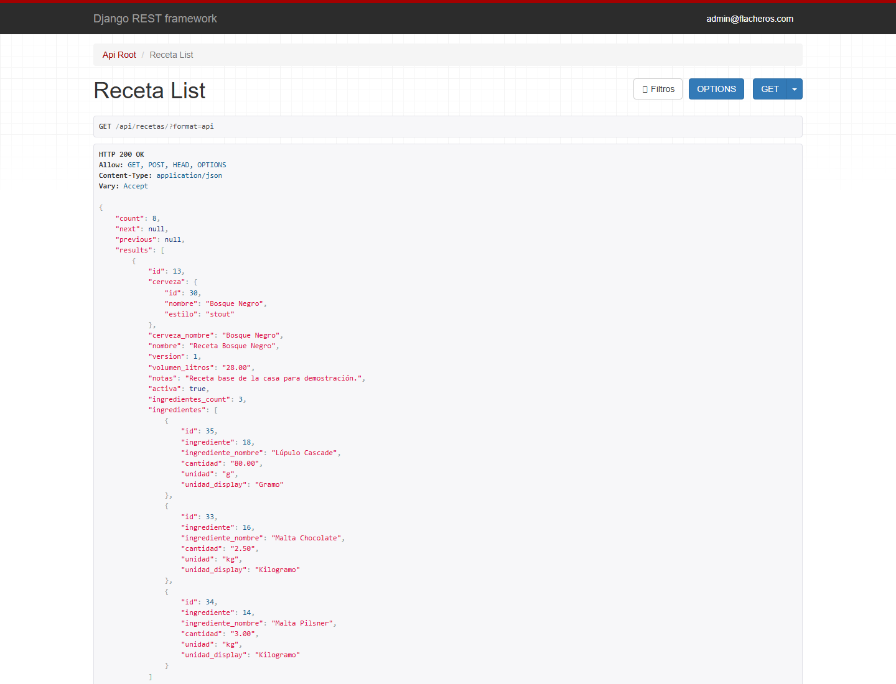

# Cervecería Los Flacheros — Backend Django

Backend del EFI **Cervecería Los Flacheros**, un sistema de gestión para una
cervecería artesanal de Córdoba. El proyecto cubre dos frentes:

- **Sitio público**: catálogo de cervezas, estilos, reseñas y pedidos.
- **Panel interno**: administración de producción (recetas, ingredientes,
  lotes), ventas (clientes, pedidos) y usuarios.

Expone una **API REST** pensada para el frontend **Next.js** del equipo, con
autenticación JWT y sesión, paginación, filtros, búsqueda, ordenamiento y
documentación OpenAPI.

## Integrantes

| Nombre y apellido | Legajo | Rol |
|---|---|---|
| Federico Arballo | No informado | Backend / Frontend |
| Emanuel Cepeda Caceres | No informado | Backend / Frontend |

> El repositorio y la gestión de ramas los administra el grupo.

## Stack y versiones

| Tecnología | Versión | Uso |
|---|---|---|
| Python | 3.12.11 | Lenguaje |
| Django | 6.1.2 | Framework web |
| Django REST Framework | 3.18.3 | API REST |
| SimpleJWT | 5.5.1 | Autenticación JWT |
| drf-spectacular | 0.30.0 | OpenAPI, Swagger y ReDoc |
| django-filter | 26.2 | Filtros de querystring |
| django-cors-headers | 4.9.0 | CORS para el frontend |
| django-environ | 0.14.0 | Variables de entorno |
| psycopg | 3.3.6 | Driver PostgreSQL |
| Gunicorn | 26.2.0 | Servidor WSGI de producción |
| WhiteNoise | 6.12.0 | Archivos estáticos en producción |
| uv | 0.12.5 | Gestión de dependencias y entorno |
| SQLite | — | Base de datos de desarrollo/tests |
| PostgreSQL | 16 | Base de datos de Docker/producción |
| Docker + Compose | — | Contenedores |

## Arquitectura de apps

| App | Responsabilidad |
|---|---|
| `apps/cuentas` | Usuario custom autenticado por email, perfiles y roles. |
| `apps/catalogo` | Estilos, cervezas, proveedores, ingredientes, recetas y lotes. |
| `apps/ventas` | Clientes, pedidos, detalles de pedido y reseñas. |
| `apps/core` | Modelo abstracto con fechas, paginación estándar y `seed_demo`. |
| `config` | Settings por entorno, URLs raíz y router de la API. |

## Diagrama de la base de datos

El modelo de datos tiene **13 entidades**: los 11 modelos de dominio más
`Usuario` y `PerfilUsuario`. Las relaciones incluyen FK, 1:1 y la relación
muchos-a-muchos entre recetas e ingredientes resuelta con la tabla intermedia
`RecetaIngrediente`.



## Endpoints de la API

Base: `http://localhost:8000`. Todas las rutas de datos cuelgan de `/api/`.
La lectura de estilos y cervezas es pública; el resto requiere token.

| Método | Ruta | Auth | Descripción |
|---|---|---|---|
| POST | `/api/token/` | Público | Obtiene `access` y `refresh` con email y contraseña. |
| POST | `/api/token/refresh/` | Público | Renueva el `access` a partir del `refresh`. |
| GET | `/api/auth/me/` | Token | Devuelve `{usuario, perfil}` del usuario autenticado. |
| GET | `/api/perfiles/` | Token | Staff ve todos; usuario común solo el propio. |
| GET | `/api/perfiles/{id}/` | Token | Detalle de perfil (con la misma restricción). |
| GET, POST | `/api/estilos/` | Público / Token | Lista y alta de estilos. |
| GET, PUT, PATCH, DELETE | `/api/estilos/{id}/` | Público / Token | Detalle, edición y baja. |
| GET, POST | `/api/cervezas/` | Público / Token | Lista paginada y alta de cervezas. |
| GET, PUT, PATCH, DELETE | `/api/cervezas/{id}/` | Público / Token | Detalle, edición y baja. |
| GET | `/api/cervezas/estadisticas/` | Token | `{total, estilos, stockTotal, precioPromedio}`. |
| GET | `/api/cervezas/bajo-stock/?umbral=10` | Token | Cervezas con `stock < umbral`, paginadas. |
| GET, POST | `/api/proveedores/` | Token | Lista y alta de proveedores. |
| GET, PUT, PATCH, DELETE | `/api/proveedores/{id}/` | Token | Detalle, edición y baja. |
| GET, POST | `/api/ingredientes/` | Token | Lista y alta de ingredientes. |
| GET, PUT, PATCH, DELETE | `/api/ingredientes/{id}/` | Token | Detalle, edición y baja. |
| GET, POST | `/api/recetas/` | Token | Lista y alta de recetas. |
| GET, PUT, PATCH, DELETE | `/api/recetas/{id}/` | Token | Detalle, edición y baja. |
| GET, POST | `/api/lotes/` | Token | Lista y alta de lotes. |
| GET, PUT, PATCH, DELETE | `/api/lotes/{id}/` | Token | Detalle, edición y baja. |
| POST | `/api/lotes/{id}/finalizar/` | Token | Pasa el lote a `envasado` y asigna vencimiento. |
| GET, POST | `/api/clientes/` | Token | Lista y alta de clientes. |
| GET, PUT, PATCH, DELETE | `/api/clientes/{id}/` | Token | Detalle, edición y baja. |
| GET, POST | `/api/pedidos/` | Token | Lista y alta de pedidos. |
| GET, PUT, PATCH, DELETE | `/api/pedidos/{id}/` | Token | Detalle, edición y baja. |
| POST | `/api/pedidos/{id}/cambiar-estado/` | Token | Cambia el estado validando las choices. |
| GET, POST | `/api/detalles-pedido/` | Token | Lista y alta de líneas de pedido. |
| GET, PUT, PATCH, DELETE | `/api/detalles-pedido/{id}/` | Token | Detalle, edición y baja. |
| GET, POST | `/api/resenas/` | Token | Lista y alta de reseñas. |
| GET, PUT, PATCH, DELETE | `/api/resenas/{id}/` | Token | Detalle, edición y baja. |
| GET | `/api/schema/` | Público | Esquema OpenAPI en YAML. |
| GET | `/api/docs/` | Público | Swagger UI interactivo. |
| GET | `/api/redoc/` | Público | ReDoc. |
| GET | `/` | Público | Vista de bienvenida con accesos. |
| GET | `/admin/` | Sesión | Panel de administración. |

### Respuesta paginada

```json
{
  "count": 8,
  "next": "http://localhost:8000/api/cervezas/?page=2",
  "previous": null,
  "results": []
}
```

### Serialización anidada

Los viewsets con anidamiento **solo en list** son: `Ingrediente` (`proveedor`),
`Receta` (`cerveza` e `ingredientes`), `Lote` (`cerveza` y `receta`),
`Pedido` (`cliente` y `detalles`), `Reseña` (`cerveza` y `cliente`) y
`Cerveza` (`estilo_detalle`).

- **Listados**: `cervezas` devuelve `estilo` como **string slug** y
  `estilo_detalle` como objeto anidado; `pedidos` devuelve `cliente` y
  `detalles` anidados; `recetas` devuelve `cerveza` e `ingredientes`; `lotes`
  devuelve `cerveza` y `receta`; `resenas` devuelve `cerveza` y `cliente`;
  `ingredientes` devuelve `proveedor`.
- **Detalle y escritura**: se usan serializers planos. En cervezas, `estilo`
  es siempre el **slug** (`"ipa"`), no un id ni un objeto. Esto mantiene
  compatibilidad con el catálogo del frontend Next.js.

## Autenticación

La API acepta **JWT** (para el frontend) y **sesión de Django** (para la API
navegable y el admin).

### Obtener el token

```bash
curl -X POST http://localhost:8000/api/token/ \
  -H "Content-Type: application/json" \
  -d '{"email": "admin@flacheros.com", "password": "admin12345"}'
```

Respuesta:

```json
{
  "access": "<token de acceso>",
  "refresh": "<token de refresco>"
}
```

El `access` dura 8 horas y el `refresh` 1 día (configurable en
`SIMPLE_JWT`).

### Usar el token

```bash
curl http://localhost:8000/api/cervezas/ \
  -H "Authorization: Bearer <access>"
```

### Refrescar el token

```bash
curl -X POST http://localhost:8000/api/token/refresh/ \
  -H "Content-Type: application/json" \
  -d '{"refresh": "<refresh>"}'
```

### Sesión

La API navegable (`/api/`) y el admin (`/admin/`) usan la sesión de Django.
Iniciá sesión en `/admin/login/` y el navegador enviará la cookie de sesión.

## Paginación, filtros, búsqueda y ordering

- Paginación global: `page` y `page_size` (máximo 100; por defecto 10).
- Búsqueda: `search=<texto>`.
- Ordenamiento: `ordering=<campo>` o `ordering=-<campo>`.
- Los filtros se combinan con `&`.

| Recurso | `search` | Filtros | `ordering` |
|---|---|---|---|
| Estilos | `nombre`, `slug` | — | `nombre` |
| Cervezas | `nombre`, `descripcion`, `estilo__nombre` | `estilo` (slug), `activo`, `graduacion_min`, `graduacion_max`, `precio_min`, `precio_max` | `nombre`, `precio`, `stock`, `graduacion`, `amargor`, `creado_en` |
| Proveedores | `nombre`, `contacto`, `email`, `cuit` | `activo` | `nombre` |
| Ingredientes | `nombre`, `proveedor__nombre` | `tipo`, `unidad`, `proveedor`, `bajo_minimo` | `nombre`, `stock` |
| Recetas | `nombre`, `cerveza__nombre` | `cerveza`, `activa` | `nombre`, `version`, `creado_en` |
| Lotes | `codigo`, `cerveza__nombre` | `estado`, `cerveza`, `fecha_desde`, `fecha_hasta` | `codigo`, `fecha_elaboracion`, `volumen_litros`, `estado` |
| Clientes | `nombre`, `email`, `telefono` | `tipo`, `activo` | `nombre`, `email` |
| Pedidos | `cliente__nombre`, `cliente__email` | `estado`, `canal`, `cliente`, `fecha_desde`, `fecha_hasta` | `fecha_pedido`, `total`, `estado` |
| Detalles de pedido | `cerveza__nombre`, `pedido__cliente__nombre` | `pedido`, `cerveza` | `pedido`, `cantidad` |
| Reseñas | `cerveza__nombre`, `cliente__nombre`, `comentario` | `cerveza`, `cliente`, `puntuacion_min` | `puntuacion`, `creado_en` |

Ejemplo:

```bash
curl "http://localhost:8000/api/cervezas/?search=valle&estilo=ipa&ordering=-precio&page=1&page_size=2"
```

`bajo_minimo` acepta `true`/`false` y compara `stock < stock_minimo`.
`fecha_desde` y `fecha_hasta` se aplican sobre `fecha_elaboracion` en lotes y
sobre `fecha_pedido` en pedidos.

## Documentación

- **OpenAPI**: `/api/schema/`
- **Swagger UI**: `/api/docs/`
- **ReDoc**: `/api/redoc/`
- **API navegable**: `/api/`

El esquema se genera con drf-spectacular y se valida en cada verificación.

## Puesta en marcha local

Requisitos: Python 3.12, [uv](https://docs.astral.sh/uv/) y, opcionalmente,
Docker.

```bash
# 1. Clonar e ingresar
git clone <url-del-repo>
cd Cerveceria_Flacheros_Back_Django

# 2. Crear el archivo de entorno
cp .env.example .env          # PowerShell: Copy-Item .env.example .env

# 3. Instalar dependencias
uv sync

# 4. Migrar
uv run python manage.py migrate

# 5. Cargar datos de demostración
uv run python manage.py seed_demo

# 6. Levantar el servidor
uv run python manage.py runserver
```

- Bienvenida: <http://127.0.0.1:8000/>
- Admin: <http://127.0.0.1:8000/admin/>
- Swagger: <http://127.0.0.1:8000/api/docs/>

### Variables de entorno

`.env.example` incluye:

| Variable | Descripción |
|---|---|
| `SECRET_KEY` | Clave secreta de Django. Obligatoria en producción. |
| `DEBUG` | `True` en desarrollo, `False` en producción. |
| `ALLOWED_HOSTS` | Hosts separados por coma. |
| `DJANGO_SETTINGS_MODULE` | `config.settings.dev` o `config.settings.prod`. |
| `DATABASE_URL` | `sqlite:///db.sqlite3` o URL de PostgreSQL. |
| `POSTGRES_DB`, `POSTGRES_USER`, `POSTGRES_PASSWORD` | Credenciales del servicio `db`. |
| `CORS_ALLOWED_ORIGINS` | Orígenes permitidos del frontend. |
| `CSRF_TRUSTED_ORIGINS` | Orígenes confiables para CSRF. |

### Datos de demostración

```bash
uv run python manage.py seed_demo
uv run python manage.py seed_demo --reset   # borra solo datos de dominio
```

El comando es **idempotente**: se puede ejecutar varias veces sin duplicar
datos. Carga 6 estilos, 8 cervezas, 4 proveedores, 11 ingredientes, 8 recetas,
8 lotes, 6 clientes, 6 pedidos y 12 reseñas. No toca usuarios, salvo el
superusuario demo.

**Credenciales demo**

| Campo | Valor |
|---|---|
| Email | `admin@flacheros.com` |
| Contraseña | `admin12345` |
| Rol de perfil | `admin` |

## Docker

```bash
cp .env.example .env          # PowerShell: Copy-Item .env.example .env
# Editar SECRET_KEY y, si hace falta, POSTGRES_* y ALLOWED_HOSTS
docker compose up --build
```

> Si el daemon de Docker no está corriendo, `docker compose config` permite
> validar la configuración sin levantar los contenedores.

El compose levanta:

- `db`: PostgreSQL 16 con volumen persistente y healthcheck.
- `web`: Django con Gunicorn, migraciones y `collectstatic` automáticos en el
  entrypoint (`docker/entrypoint.sh`).

El compose fuerza `DEBUG=False` y
`DJANGO_SETTINGS_MODULE=config.settings.prod`; las migraciones y
`collectstatic` corren solas en el entrypoint.

Variables principales: `SECRET_KEY` (obligatoria), `POSTGRES_*`,
`ALLOWED_HOSTS`, `CORS_ALLOWED_ORIGINS` y `CSRF_TRUSTED_ORIGINS`. La URL de
base se construye como
`postgres://<user>:<password>@db:5432/<database>`.

## Tests

```bash
uv run python manage.py test -v 2
```

La batería tiene **39 tests** con `APITestCase` y base de datos real (sin
mocks). Cubre:

- Autenticación: token por email, password incorrecta, `me` con/sin token,
  perfiles propios vs. ajenos y visibilidad para staff.
- Cervezas: listado paginado, `estilo` string en list/detalle y
  `estilo_detalle` anidado solo en list, payload del front con `color: ""` e
  `imagen: ""`, permisos de escritura, CRUD, búsqueda, filtro por estilo,
  ordering, `page_size`, estadísticas y bajo stock (incluido umbral inválido).
- Catálogo: estilos públicos, proveedores con/sin token, ingredientes bajo
  mínimo, recetas anidadas en list y planas en detalle, lotes anidados,
  `finalizar` y CRUD de reseñas.
- Ventas: pedidos anidados en list vs. planos en detalle, cambio de estado
  válido/inválido, recálculo del total al crear un detalle y clientes con/sin
  token.
- Admin: smoke test de `/admin/` y de los changelists de los 11 modelos de
  dominio con superusuario.

## Panel de administración

URL: <http://127.0.0.1:8000/admin/>. Credenciales demo:
`admin@flacheros.com` / `admin12345`.

| Modelo | Filtros | Búsqueda | Orden |
|---|---|---|---|
| Estilo | `creado_en` | nombre, slug, descripción | nombre |
| Cerveza | estilo, activo | nombre, estilo, descripción | nombre |
| Proveedor | activo | nombre, contacto, email, CUIT | nombre |
| Ingrediente | tipo, unidad, proveedor | nombre, proveedor | nombre |
| Receta | activa, estilo de cerveza | nombre, cerveza | cerveza, -versión |
| RecetaIngrediente | unidad, cerveza de la receta | receta, ingrediente | receta, ingrediente |
| Lote | estado, estilo de cerveza | código, cerveza, receta | -fecha de elaboración |
| Cliente | tipo, activo | nombre, email, teléfono | nombre |
| Pedido | estado, canal, fecha | cliente, email, notas | -fecha del pedido |
| DetallePedido | estilo de cerveza | pedido, cerveza | pedido, cerveza |
| Reseña | puntuación, estilo | cerveza, cliente, comentario | -creado en |
| Usuario | — | email, nombre, apellido | email |
| PerfilUsuario | rol | email, teléfono | email |

Cerveza permite edición en línea de `precio`, `stock` y `activo`. Pedido
muestra `total` y `cantidad_items` como campos calculados de solo lectura.
Receta y Pedido incluyen inlines de sus ingredientes y detalles,
respectivamente.

## Integración con el frontend Next.js

En el `.env.local` del frontend:

```env
NEXT_PUBLIC_USE_MOCK=false
NEXT_PUBLIC_API_URL=http://localhost:8000/api/
```

El backend ya permite los orígenes de desarrollo:

```env
CORS_ALLOWED_ORIGINS=http://localhost:3000,http://127.0.0.1:3000
CSRF_TRUSTED_ORIGINS=http://localhost:3000,http://127.0.0.1:3000
```

Flujo recomendado:

1. `POST /api/token/` con `{email, password}`.
2. Guardar `access` y `refresh`.
3. Enviar `Authorization: Bearer <access>` en cada request privada.
4. Ante un `401`, renovar con `POST /api/token/refresh/`.
5. Respetar la paginación `{count, next, previous, results}` y los errores
   por campo de DRF (`{"campo": ["mensaje"]}`).

Contrato diferencial:

- `GET /api/cervezas/` → `estilo` es un **string slug** (`"pilsner"`, `"ipa"`,
  etc.) y `estilo_detalle` es el objeto anidado con `slug`, `nombre`, etc.
- `GET /api/cervezas/{id}/` → `estilo` es un **string slug**; no incluye
  `estilo_detalle`.
- `GET /api/pedidos/` → `cliente` y `detalles` anidados.
- `GET /api/pedidos/{id}/` → `cliente` es un **id** y no incluye `detalles`.

> **Compatibilidad con el front:** `estilo` siempre es string en el catálogo.
> Usar `estilo_detalle` solo si se necesita el objeto completo en el listado.

## Checklist de requisitos de la cátedra

| Requisito | Dónde se cumple |
|---|---|
| 10+ modelos | 11 modelos de dominio + `Usuario` y `PerfilUsuario`. |
| 8+ viewsets | 11 viewsets registrados en `config/api_urls.py`. |
| 2+ serializers anidados solo en list | Ingredientes, recetas, lotes, pedidos, reseñas y cervezas (`estilo_detalle`). |
| 2+ `@action` | `estadisticas`, `bajo-stock`, `finalizar` y `cambiar-estado`. |
| Auth por sesión y por token | `SessionAuthentication` + SimpleJWT; admin y API navegable. |
| Paginación | `PaginacionEstandar` con `page` y `page_size`. |
| Filtros | `django-filter` en catálogo y ventas. |
| Búsqueda y ordering | `SearchFilter` y `OrderingFilter` por recurso. |
| Documentación | `/api/schema/`, `/api/docs/` y `/api/redoc/`. |
| Vista template | `/` con `templates/bienvenida.html`. |
| Admin completo | 11 modelos de dominio + usuarios y perfiles, con filtros, búsqueda, orden e inlines. |
| uv | `pyproject.toml`, `uv.lock` y comandos con `uv run`. |
| CORS | `django-cors-headers` y orígenes configurables. |
| Docker | `Dockerfile`, `docker-compose.yml` y `docker/entrypoint.sh`. |
| Tests | 39 tests con `APITestCase` y base real. |
| Datos demo | `python manage.py seed_demo` idempotente. |

## Flujo de Git sugerido

El repositorio lo administra el grupo. Se sugiere:

- `main` estable y protegida; cada feature en una rama
  `feature/<tema>` (por ejemplo `feature/seed-demo`,
  `feature/tests-api`, `feature/readme`).
- Commits con convención: `feat:`, `fix:`, `test:`, `docs:`, `chore:`.
- Pull Request hacia `main` con descripción, checklist y revisión de al menos
  un integrante.
- Mantener `uv.lock` versionado y ejecutar `uv run python manage.py test`
  antes de abrir el PR.
- No commitear `.env`, `db.sqlite3`, `staticfiles/` ni `media/`.

> Esta entrega no ejecutó comandos git; los cambios quedan en el árbol de
> trabajo para que el grupo los revise y versione.

## Capturas

Las capturas se generaron contra el entorno local con `seed_demo`.

### Portada



### Swagger UI



### Admin de Django





### Admin de cervezas



### Listado de la API



### Serialización anidada en list



## Estructura de carpetas

```text
.
├── apps/
│   ├── core/
│   │   ├── management/commands/seed_demo.py
│   │   ├── models.py
│   │   └── pagination.py
│   ├── cuentas/
│   │   ├── models.py
│   │   ├── serializers.py
│   │   ├── views.py
│   │   └── tests/
│   ├── catalogo/
│   │   ├── models.py
│   │   ├── serializers.py
│   │   ├── filters.py
│   │   ├── views.py
│   │   └── tests/
│   └── ventas/
│       ├── models.py
│       ├── serializers.py
│       ├── filters.py
│       ├── views.py
│       └── tests/
├── config/
│   ├── api_urls.py
│   ├── urls.py
│   └── settings/
│       ├── base.py
│       ├── dev.py
│       └── prod.py
├── docker/entrypoint.sh
├── templates/bienvenida.html
├── docker-compose.yml
├── Dockerfile
├── manage.py
├── pyproject.toml
├── uv.lock
└── README.md
```

## Decisiones técnicas relevantes

- **Usuario custom por email**: `Usuario` redefine `USERNAME_FIELD = "email"`,
  usa un manager propio y crea el `PerfilUsuario` automáticamente por signal.
  SimpleJWT toma el email como credencial.
- **`estilo` string slug + `estilo_detalle`**: `estilo` es siempre un string
  (`"ipa"`) tanto en list como en detalle, para que el catálogo del front no
  se rompa. En list se agrega `estilo_detalle` con el objeto completo para
  cumplir el requisito de datos anidados sin duplicar la lógica de escritura.
- **Total calculado**: `Pedido.total` se recalcula desde los detalles
  (`recalcular_total`) al crear, editar o borrar una línea. En la API es de
  solo lectura para no aceptar totales inconsistentes.
- **`imagen` como URL**: el modelo usa `URLField`; no se suben archivos. El
  front consume la URL directamente.
- **`precio_unitario` opcional**: si no se envía al crear un detalle, el
  modelo toma `cerveza.precio`; el subtotal se calcula solo.
- **Consultas optimizadas**: `select_related` y `prefetch_related` en los
  viewsets, más `annotate` para contadores (`resenas_count`,
  `cervezas_count`, `ingredientes_count`, `pedidos_count`,
  `detalles_count`).
- **Permisos**: catálogo público de solo lectura con
  `IsAuthenticatedOrReadOnly`; el resto requiere `IsAuthenticated`.
- **Schema limpio**: `ENUM_NAME_OVERRIDES` evita colisiones entre los enums
  `estado` y `tipo`; las actions y `MeView` están documentadas con
  `@extend_schema`.
- **Seed idempotente**: `update_or_create`/`get_or_create` y `--reset` seguro
  para datos de dominio, sin tocar usuarios.


